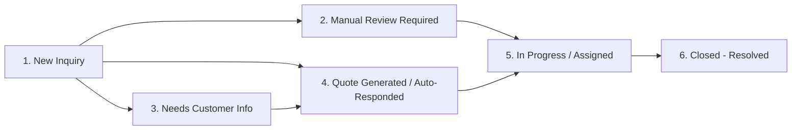
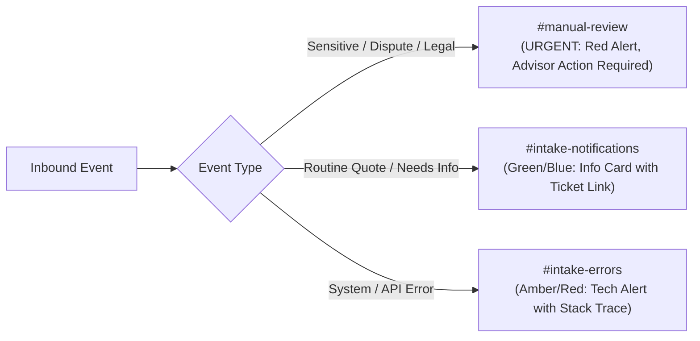
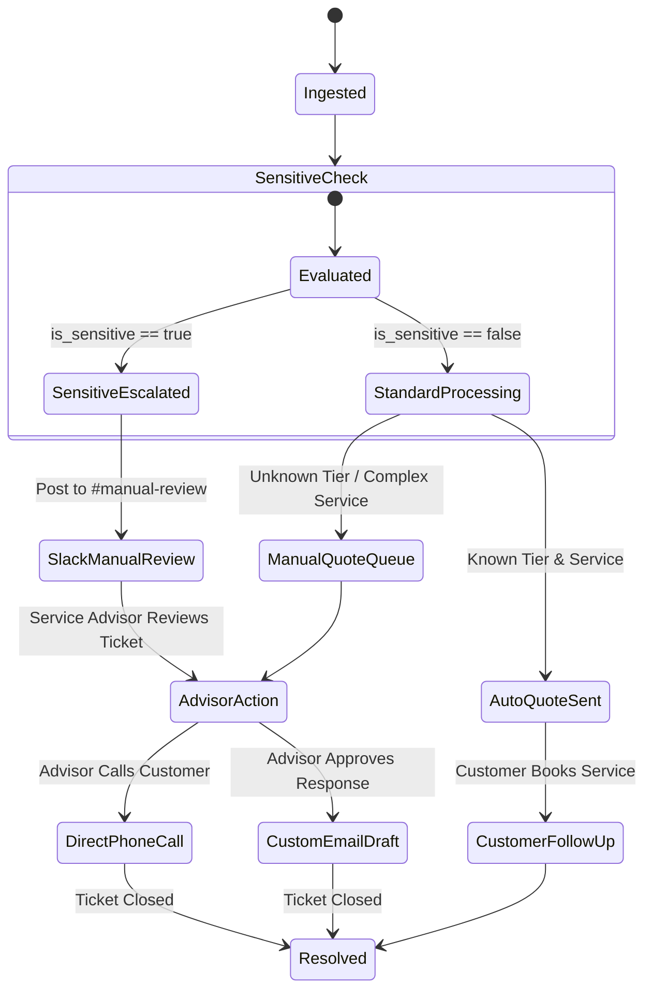

# Autonomous AI Intake Agent — System Architecture & Specification

**Client / Business:** Marcus Vance Automotive  
**Engine:** n8n (Automation Engine)  
**CRM:** HubSpot CRM  
**Email Channel:** Gmail (Inbound & Outbound)  
**Team Alerts & Human Escalation:** Slack  
**Master Activity Log:** Google Sheets  
**Intelligence Layer:** AI Model (Structured Classification, Extraction, Sentiment, Summarization, Email Drafting)  

---

## 1. System Architecture

The Autonomous AI Intake Agent is an enterprise-grade automated intake pipeline designed to process all inbound customer communications for Marcus Vance Automotive with deterministic safety, CRM synchronization, strict pricing accuracy, automated team routing, and automated logging.

```mermaid
flowchart TD
    A[Inbound Email via Gmail] --> B[Generate Unique IDs:\n- Internal Inquiry ID (UUID)\n- Tracking Number (TRK-YYYYMMDD-XXXX)]
    
    B --> C[HubSpot CRM:\nCreate Support Ticket & Contact]
    
    C --> D[Google Sheets:\nLog Ticket Creation Event]
    
    D --> E[AI Analysis Engine:\nClassification, Extraction, Sentiment, Sensitivity Detection]
    
    E --> F{Is Sensitive / Escalation?}
    
    %% Sensitive Path
    F -- YES --> G[Update HubSpot Ticket:\n- Stage: Manual Review Required\n- is_sensitive: TRUE\n- Log AI Summary]
    G --> H[Slack Alert to #manual-review\nwith Ticket & Sheet links]
    H --> I[Google Sheets:\nLog Escalation Status]
    I --> J[STOP: NEVER Send Automated Email]
    
    %% Non-Sensitive Path
    F -- NO --> K{Missing Required Info?}
    
    K -- YES --> L[Update HubSpot Ticket:\n- Stage: Needs Customer Info\n- Log AI Summary]
    L --> M[Slack Alert to #intake-notifications]
    M --> N[Gmail: Send Missing Info Request\nwith Tracking Number]
    N --> O[Google Sheets:\nLog Follow-up Sent]
    
    K -- NO --> P[Pricing Engine Lookup:\nStrict Pricing Table Match]
    P --> Q{Vehicle Tier & Service Found?}
    
    Q -- YES --> R[Pricing Status: Quoted Automatically\nCalculate Estimated Cost]
    Q -- NO --> S[Pricing Status: Manual Quote Required\nCost: null / Manual]
    
    R --> T[Update HubSpot Ticket:\n- Stage: Quote Generated\n- Tier, Services, Quote Amount]
    S --> T
    
    T --> U[Gmail: Send Confirmation / Quote Email\nwith Tracking Number]
    U --> V[Slack Alert to #intake-notifications]
    V --> W[Google Sheets:\nLog Final Completed Status]
    
    %% Error Catching
    C -. Error .-> ERR[Error Handler Catch Node]
    E -. Error .-> ERR
    P -. Error .-> ERR
    U -. Error .-> ERR
    ERR --> X[Slack Alert to #intake-errors]
    ERR --> Y[Google Sheets: Log Error Record]
    ERR --> Z[Update HubSpot Ticket: Needs Attention]
```

### Core Architecture Principles & Business Invariants

1. **CRM Ticket First (Rule #6)**: The CRM Support Ticket is **always** created before AI classification, pricing calculation, Slack notification, CRM pipeline movement, or automated email dispatch. This guarantees that no inquiry is ever lost, even if downstream AI or network services fail.
2. **Deterministic Dual-ID Scheme (Rule #7)**:
   - **Internal Inquiry ID**: Machine-readable UUID (e.g., `inq_9f8b2c4e-1a2b-4c3d-8e4f-5a6b7c8d9e0f`) for internal system tracing, idempotency, and database keys.
   - **Customer Tracking Number**: Human-readable reference formatted as `TRK-YYYYMMDD-XXXX` (e.g., `TRK-20260820-8492`), included in all email subjects, CRM tickets, Slack messages, and Google Sheet rows.
3. **Absolute Sensitivity Quarantine (Rules #5, #12, #13)**: Any inquiry mentioning refunds, legal threats, attorney representation, dispute, chargeback, regulatory complaint, or severe dissatisfaction is quarantined instantly. It routes exclusively to the `#manual-review` Slack channel, and automated email replies are strictly inhibited.
4. **Zero-Hallucination Pricing Engine (Rules #4, #10, #11)**: Prices are never estimated, hallucinated, or extrapolated by AI. Pricing is derived strictly from a static lookup table by Service Code and Vehicle Tier. If vehicle details or service type are ambiguous, the pricing status is set to `"Manual Quote Required"` and no speculative dollar amounts are quoted.
5. **Comprehensive Activity Logging (Rule #8)**: Every state transition (ticket created, AI evaluated, pricing evaluated, email sent, error encountered) is logged to the Google Sheets Master Activity Log.
6. **Graceful Degradation & Safe Failure (Rule #9)**: If any required attribute is missing or any subsystem fails, the pipeline degrades to safe human-review states without dropping context.

---

## 2. n8n Workflow Architecture

The n8n workflow executes sequentially with branch points and dedicated error handlers.

### Detailed Node Execution Sequence

```
[1. Gmail Inbound Trigger (Poll/Push)]
       │
       ▼
[2. Idempotency & Clean Input Formatter]
       │  (Extract Message-ID, Sender Email, Subject, Body, Timestamp)
       ▼
[3. Generate Inquiry ID & Tracking Number]
       │  (Inquiry ID = UUIDv4, Tracking Number = TRK-YYYYMMDD-XXXX)
       ▼
[4. HubSpot: Search or Create Contact]
       │  (Look up by email; create if new, update timestamp if existing)
       ▼
[5. HubSpot: Create Support Ticket]  <-- STRICT INVARIANT: Ticket Created First
       │  (Subject: [TRK-YYYYMMDD-XXXX] Inbound Inquiry, Status: New Inquiry)
       ▼
[6. Google Sheets: Append Row (Initial State)]
       │  (Record: Timestamp, Inquiry ID, Tracking Number, Ticket ID, Status: CREATED)
       ▼
[7. AI Analysis Engine (LangChain/OpenAI/Gemini Node)]
       │  (Extracts: Intent, Vehicle, Tier, Services, Missing Info, Sentiment, Sensitivity)
       ▼
[8. Data Validation & Formatting Code Node]
       │  (Validate AI JSON schema, parse booleans, normalize vehicle tiers)
       ▼
[9. Switch: Sensitivity Gate]
      ├── TRUE  ──> [10a. HubSpot Update: Stage = Manual Review Required]
      │                   │
      │                   ▼
      │             [11a. Slack: Post Escalation Card to #manual-review]
      │                   │
      │                   ▼
      │             [12a. Google Sheets: Update Row Status = MANUAL_REVIEW]
      │                   │
      │                   ▼
      │             [13a. STOP (NO Automated Email Sent)]
      │
      └── FALSE ──> [10b. Switch: Missing Required Info?]
                          ├── YES ──> [11b. HubSpot Update: Stage = Needs Customer Info]
                          │                 │
                          │                 ▼
                          │           [12b. Gmail: Send Needs Info Email]
                          │                 │
                          │                 ▼
                          │           [13b. Slack: Post Notice to #intake-notifications]
                          │                 │
                          │                 ▼
                          │           [14b. Google Sheets: Update Row Status = AWAITING_INFO]
                          │
                          └── NO  ──> [11c. Pricing Engine (Code / Lookup Table)]
                                            │  (Lookup Service + Vehicle Tier; fallback to Manual Quote)
                                            ▼
                                      [12c. HubSpot Update: Stage = Quote Ready / Auto-Responded]
                                            │  (Set vehicle specs, tier, quote amount, AI summary)
                                            ▼
                                      [13c. Gmail: Send Quote / Intake Confirmation Email]
                                            │  (Include Tracking Number, breakdown, next steps)
                                            ▼
                                      [14c. Slack: Post Success Card to #intake-notifications]
                                            │
                                            ▼
                                      [15c. Google Sheets: Update Row Status = PROCESSED]
```

### Global Error Handling Sub-Workflow

Every node connects to a global `Error Trigger` in n8n:
1. Catches unhandled exceptions (API rate limits, authentication failures, network timeouts, invalid payloads).
2. Posts an urgent alert to Slack `#intake-errors` detailing node name, error message, Inquiry ID, Tracking Number, and raw input payload.
3. Updates the HubSpot Ticket status to `Needs Attention` (if ticket exists).
4. Appends/updates the Google Sheets log with `Processing Status = FAILED` and the exact error trace.

---

## 3. Required Credentials & API Connections

| System | Connection Type | Required Permissions / Scopes | Use Case |
| :--- | :--- | :--- | :--- |
| **n8n** | Self-Hosted / Cloud | Admin API access, webhook endpoints | Workflow execution engine |
| **HubSpot CRM** | Private App Token | `crm.objects.contacts.read`, `crm.objects.contacts.write`, `crm.objects.tickets.read`, `crm.objects.tickets.write`, `crm.schemas.tickets.read`, `crm.schemas.tickets.write` | Contact search/creation, Ticket creation, pipeline updates, custom property syncing |
| **Gmail** | OAuth2 / Google Workspace | `https://www.googleapis.com/auth/gmail.readonly`, `https://www.googleapis.com/auth/gmail.send`, `https://www.googleapis.com/auth/gmail.modify` | Inbound intake email monitoring, outbound quote/confirmation dispatch |
| **Slack** | Bot User OAuth Token | `chat:write`, `chat:write.public`, `channels:read`, `incoming-webhook` | Alerts to `#intake-notifications`, `#manual-review`, `#intake-errors` |
| **Google Sheets** | OAuth2 / Service Account | `https://www.googleapis.com/auth/spreadsheets`, `https://www.googleapis.com/auth/drive.file` | Real-time audit trail and master activity logging |
| **AI Model** | API Key (Gemini / OpenAI / Anthropic) | Model inference endpoint (`gpt-4o` / `gemini-1.5-pro` / `claude-3-5-sonnet`) | Structured JSON extraction, classification, sentiment, email drafting |

---

## 4. Required HubSpot Objects

The system interacts with two core CRM object types:

1. **Contacts (`contacts`)**:
   - Matches inbound inquiry by email.
   - If contact does not exist, creates a new contact with Name, Email, and Phone.
   - Associated to the Ticket via HubSpot Associations API.
2. **Tickets (`tickets`)**:
   - Represents the specific intake case.
   - Created immediately on email receipt.
   - Contains all custom tracking, classification, vehicle, and pricing properties.

---

## 5. Required HubSpot Ticket Properties

Custom ticket properties must be configured in HubSpot under the `ticket` object group `intake_agent`:

| Property Internal Name | Label | Type | Description / Options |
| :--- | :--- | :--- | :--- |
| `inquiry_id` | Inquiry ID | Single-line Text | Internal UUID generated at intake (Unique) |
| `tracking_number` | Tracking Number | Single-line Text | Format: `TRK-YYYYMMDD-XXXX` (Indexed) |
| `inquiry_category` | Inquiry Category | Dropdown Select | `routine_maintenance`, `mechanical_repair`, `body_paint`, `diagnostic`, `quote_inquiry`, `appointment_reschedule`, `sensitive_complaint`, `general_inquiry`, `other` |
| `vehicle_year` | Vehicle Year | Number | 4-digit manufacturing year |
| `vehicle_make` | Vehicle Make | Single-line Text | e.g., Toyota, Ford, BMW, Porsche |
| `vehicle_model` | Vehicle Model | Single-line Text | e.g., Camry, F-150, 330i, 911 |
| `vehicle_vin` | Vehicle VIN | Single-line Text | 17-character Vehicle Identification Number |
| `vehicle_tier` | Vehicle Tier | Dropdown Select | `tier_1_sedan_coupe`, `tier_2_suv_crossover`, `tier_3_truck_van_diesel`, `tier_4_exotic_commercial`, `unknown_manual` |
| `services_requested` | Services Requested | Multi-line Text / Checkbox | e.g., Oil Change, Brake Inspection, Diagnostic, Transmission Flush |
| `estimated_cost` | Estimated Cost | Currency (USD) | Total estimated cost calculated from pricing table |
| `pricing_status` | Pricing Status | Dropdown Select | `quoted_automatically`, `manual_quote_required`, `not_applicable` |
| `is_sensitive` | Is Sensitive Inquiry | Single Checkbox (Boolean) | `true` if legal, dispute, refund, chargeback, escalation |
| `sensitivity_reason` | Sensitivity Reason | Single-line Text | Explanation of sensitivity flag (e.g., "Customer requesting refund and threatening attorney") |
| `customer_sentiment` | Customer Sentiment | Dropdown Select | `positive`, `neutral`, `frustrated`, `hostile_escalation` |
| `ai_summary` | AI Executive Summary | Multi-line Text | 2-3 sentence distilled overview of inquiry |
| `action_taken` | Action Taken | Single-line Text | e.g., "Auto-quote sent", "Escalated to Manual Review", "Needs Info requested" |
| `gmail_thread_id` | Gmail Thread ID | Single-line Text | Reference ID to maintain email thread continuity |

---

## 6. Required HubSpot Pipeline & Stages

Pipeline Name: **Automotive Intake Pipeline** (`automotive_intake_pipeline`)



| Stage ID / Name | Probability | Description | Automated Action Upon Entry |
| :--- | :--- | :--- | :--- |
| `new_inquiry` (New Inquiry) | 10% | Ticket created immediately upon email receipt | Initial log created in Google Sheets |
| `manual_review` (Manual Review Required) | 20% | Sensitive inquiry, dispute, refund request, legal threat, or complex escalation | Slack alert to `#manual-review`; Automated email **BLOCKED** |
| `needs_info` (Needs Customer Info) | 20% | Missing required vehicle details (Year/Make/Model) or specific service request | Automated email requesting missing details; Slack notification to `#intake-notifications` |
| `quote_generated` (Quote Generated / Auto-Responded) | 40% | Standard service pricing matched and confirmation sent to customer | Quote confirmation email sent via Gmail; Slack notification to `#intake-notifications` |
| `in_progress` (In Progress / Assigned) | 70% | Human service advisor has taken ownership of ticket | Handed off to Marcus Vance service team |
| `closed_resolved` (Closed - Resolved) | 100% | Inquiry completed, service booked, or issue resolved | Final resolution timestamp recorded |

---

## 7. Google Sheets Structure (Master Activity Log)

**Spreadsheet Title:** `Marcus Vance Automotive - Master Intake Activity Log`  
**Sheet / Tab Name:** `Master_Intake_Log`  

### Column Definitions (25 Attributes)

| Col # | Column Header | Data Type | Example Value | Description |
| :---: | :--- | :--- | :--- | :--- |
| **A** | `Timestamp` | ISO 8601 Datetime | `2026-08-20T05:30:00Z` | Date and time email was received |
| **B** | `Inquiry_ID` | String (UUID) | `inq_9f8b2c4e-1a2b-4c3d` | Unique internal identifier |
| **C** | `Tracking_Number` | String | `TRK-20260820-8492` | Human-readable tracking number |
| **D** | `Customer_Email` | String | `john.doe@example.com` | Inbound sender email address |
| **E** | `Customer_Name` | String | `John Doe` | Extracted customer full name |
| **F** | `Customer_Phone` | String | `(555) 234-5678` | Extracted customer phone number |
| **G** | `Vehicle_Year` | Number | `2022` | Vehicle manufacturing year |
| **H** | `Vehicle_Make` | String | `Toyota` | Vehicle make |
| **I** | `Vehicle_Model` | String | `Camry` | Vehicle model |
| **J** | `Vehicle_VIN` | String | `4T1B11HK5NU123456` | 17-digit VIN if provided |
| **K** | `Vehicle_Tier` | String | `Tier 1 - Sedan/Coupe` | Assigned vehicle pricing tier |
| **L** | `Inquiry_Category` | String | `routine_maintenance` | AI classification |
| **M** | `Services_Requested` | String | `Synthetic Oil Change, Brake Inspection` | Extracted services |
| **N** | `Is_Sensitive` | Boolean | `FALSE` | `TRUE` if escalation/legal/dispute/refund |
| **O** | `Sensitivity_Reason` | String | `None` | Reason if sensitive |
| **P** | `Estimated_Cost` | Currency / Number | `89.95` | Quoted amount (or empty if manual) |
| **Q** | `Pricing_Status` | String | `Quoted Automatically` | `Quoted Automatically` \| `Manual Quote Required` |
| **R** | `Customer_Sentiment` | String | `Neutral` | `Positive`, `Neutral`, `Frustrated`, `Hostile` |
| **S** | `AI_Summary` | String | `Customer requests oil change for 2022 Camry next Tuesday.` | Concise summary |
| **T** | `HubSpot_Contact_ID` | String | `cnt_102938` | Associated HubSpot Contact ID |
| **U** | `HubSpot_Ticket_ID` | String | `tkt_582910` | Associated HubSpot Ticket ID |
| **V** | `HubSpot_Stage` | String | `Quote Generated` | Current pipeline stage |
| **W** | `Slack_Channel_Notified` | String | `#intake-notifications` | Target Slack channel |
| **X** | `Automated_Email_Sent` | Boolean | `TRUE` | Whether auto email was sent |
| **Y** | `Processing_Status` | String | `SUCCESS` | `SUCCESS`, `MANUAL_REVIEW`, `AWAITING_INFO`, `FAILED` |
| **Z** | `Error_Details` | String | `None` | Error trace if failure occurred |

---

## 8. Slack Channels & Alerting Strategy

Three dedicated Slack channels separate operational noise from urgent human escalations:



### Channel 1: `#manual-review` (URGENT Human-in-the-Loop)
- **Target Audience:** Marcus Vance, Senior Service Managers, Customer Relations.
- **Trigger Conditions:** `is_sensitive == true` (Disputes, refunds, legal threats, damage claims, severe hostility).
- **Message Format:** Slack Block Kit with high-visibility red banner:
  - 🚨 **URGENT: Sensitive Customer Inquiry Detected**
  - **Tracking Number:** `TRK-20260820-8492` | **Inquiry ID:** `inq_9f8b2c4e...`
  - **Customer:** John Doe (`john.doe@example.com` | `(555) 234-5678`)
  - **Sensitivity Trigger:** Refund demand / Threatened legal action
  - **AI Summary:** "Customer demanding full refund for brake repair performed last week, citing squeaking noise and threatening attorney review."
  - **Sentiment:** Hostile / Escalation
  - **Direct Actions:** Link to [HubSpot Ticket](https://app.hubspot.com) | Link to [Google Sheets Log](https://docs.google.com)
  - **Notice:** ⚠️ *Automated email response has been STRICTLY SUPPRESSED.*

### Channel 2: `#intake-notifications` (Routine Operations)
- **Target Audience:** Service Advisors, Front Desk Staff.
- **Trigger Conditions:** Standard quotes generated, routine inquiries, requests for missing vehicle info.
- **Message Format:** Clean status card:
  - 📋 **New Intake: Quote Generated** (or ⚠️ **Needs Customer Info**)
  - **Tracking Number:** `TRK-20260820-8492`
  - **Customer:** Jane Smith (`jane@example.com`)
  - **Vehicle:** 2021 Ford F-150 (Tier 3 - Truck)
  - **Service:** Synthetic Oil Change & Tire Rotation
  - **Quote Sent:** `$129.95` (Automated response sent via Gmail)
  - **Link:** [View in HubSpot](https://app.hubspot.com)

### Channel 3: `#intake-errors` (Engineering & System Health)
- **Target Audience:** System Administrators, DevOps.
- **Trigger Conditions:** HubSpot API rate limit/error, Gmail send failure, AI schema validation error, Google Sheets write error.
- **Message Format:**
  - 🛑 **Intake Pipeline Failure**
  - **Failed Node:** `HubSpot_Create_Ticket` / `AI_JSON_Parser`
  - **Inquiry ID:** `inq_9f8b2c4e...` | **Tracking Number:** `TRK-20260820-8492`
  - **Error Trace:** `401 Unauthorized - Invalid HubSpot Token`
  - **Action Taken:** Inquiry cached; Ticket marked for administrative retry.

---

## 9. AI Processing & Structured Output Architecture

The AI layer operates strictly as an extractor and classifier with temperature `0.0` to eliminate hallucination.

### AI System Prompt Specification

```text
You are the AI intake analysis engine for Marcus Vance Automotive.
Your job is to extract structured details, classify customer intent, detect sensitive issues, and produce an executive summary.

STRICT INVARIANTS:
1. NEVER invent, assume, or hallucinate vehicle details, VINs, or phone numbers. If not explicitly stated, return null.
2. SENSITIVE DETECTION: Mark "is_sensitive": true if the message mentions:
   - Refunds, chargebacks, or billing disputes
   - Threats of legal action, lawyers, attorneys, or lawsuits
   - Regulatory complaints (BBB, Consumer Protection, Attorney General)
   - Accusations of vehicle damage caused by shop
   - Extreme anger or hostility demanding manager escalation
3. If "is_sensitive" is true, provide the exact trigger phrase in "sensitivity_reason".
4. Determine if critical information is missing (specifically vehicle year/make/model OR requested service).
5. Output ONLY valid JSON adhering exactly to the provided schema.
```

### JSON Schema Output Specification

```json
{
  "customer_name": "string or null",
  "customer_phone": "string or null",
  "vehicle": {
    "year": "integer or null",
    "make": "string or null",
    "model": "string or null",
    "vin": "string or null",
    "tier_guess": "tier_1_sedan_coupe | tier_2_suv_crossover | tier_3_truck_van_diesel | tier_4_exotic_commercial | unknown"
  },
  "inquiry_category": "routine_maintenance | mechanical_repair | body_paint | diagnostic | quote_inquiry | appointment_reschedule | sensitive_complaint | general_inquiry | other",
  "services_requested": ["string"],
  "missing_required_info": ["vehicle_year", "vehicle_make", "vehicle_model", "service_details"],
  "is_sensitive": false,
  "sensitivity_reason": "string or null",
  "customer_sentiment": "positive | neutral | frustrated | hostile_escalation",
  "ai_summary": "string (max 3 sentences)",
  "draft_reply_body": "string or null (used only if not sensitive and valid quote)"
}
```

---

## 10. Pricing Configuration Structure

To satisfy **Rule #4** (Never invent pricing) and **Rule #10 & #11** (Explicit pricing table, never guess, unknown tier = Manual Quote Required), the pricing engine uses a declarative lookup matrix.

### Vehicle Tier Classifications

| Tier Key | Tier Label | Typical Vehicle Types / Examples |
| :--- | :--- | :--- |
| `tier_1_sedan_coupe` | Tier 1: Sedan / Coupe / Hatchback | Toyota Camry, Honda Civic, BMW 3-Series, Ford Mustang |
| `tier_2_suv_crossover` | Tier 2: Midsize / Crossover / SUV | Toyota RAV4, Ford Explorer, Honda CR-V, Jeep Grand Cherokee |
| `tier_3_truck_van_diesel` | Tier 3: Full-Size Truck / Van / Diesel | Ford F-150/F-250, Chevy Silverado, RAM 1500, Mercedes Sprinter |
| `tier_4_exotic_commercial` | Tier 4: Exotic / European / Commercial | Porsche 911, Ferrari, Commercial Fleets, Heavy Duty (>10,000 lbs) |
| `unknown_manual` | Unknown / Indeterminate Tier | Ambiguous vehicle info or unlisted specialty model |

### Master Service Pricing Matrix (Configurable Table)

| Service Key | Service Name | Tier 1 (Sedan) | Tier 2 (SUV) | Tier 3 (Truck) | Tier 4 (Exotic) | Notes |
| :--- | :--- | :---: | :---: | :---: | :---: | :--- |
| `oil_change_synthetic` | Full Synthetic Oil & Filter Service | $79.95 | $94.95 | $119.95 | Manual Quote | Up to 5 qts synthetic (Tier 3 includes up to 8 qts) |
| `oil_change_diesel` | Heavy Duty Diesel Oil Service | N/A | N/A | $189.95 | Manual Quote | Includes heavy duty filter & 12 qts oil |
| `brake_pads_front` | Front Brake Pad Replacement | $189.00 | $219.00 | $269.00 | Manual Quote | OEM spec ceramic pads |
| `brake_pads_rotors_front` | Front Brake Pads & Rotors | $349.00 | $419.00 | $499.00 | Manual Quote | Pads & balanced disc rotors |
| `tire_rotation` | 4-Wheel Tire Rotation & Pressure Check | $29.95 | $29.95 | $39.95 | Manual Quote | Includes tread depth report |
| `coolant_flush` | Comprehensive Coolant System Flush | $149.95 | $169.95 | $199.95 | Manual Quote | Full fluid exchange |
| `transmission_flush` | Automatic Transmission Fluid Exchange | $229.00 | $259.00 | $299.00 | Manual Quote | Multi-vehicle synthetic ATF |
| `ac_recharge_r134a` | A/C System Evacuate & Recharge (R134a) | $169.00 | $189.00 | $219.00 | Manual Quote | Up to 1.5 lbs refrigerant |
| `diagnostic_fee` | Standard Diagnostic Fee (1 Hour) | $149.00 | $149.00 | $149.00 | Manual Quote | Credited toward approved repair |

### Pricing Lookup Algorithm Rules

1. **Exact Match Requirement**: Both the `Service Key` and the `Vehicle Tier` must match an active entry in the pricing matrix.
2. **Ambiguous or Multiple Services**: If any requested service is not in the explicit matrix (e.g., "engine knock investigation", "custom transmission rebuild"), the overall inquiry pricing status is marked `Manual Quote Required` and no partial quote is stated as final.
3. **Indeterminate Tier Fallback (Rule #11)**: If `vehicle_tier == "unknown_manual"`, the pricing status MUST be set to `Manual Quote Required`.
4. **Zero Dollar Suppression**: If pricing status is `Manual Quote Required`, the quote field in emails states: *"A custom quotation is being prepared by our service team based on your vehicle specifications."*

---

## 11. Error Handling & Resilience Strategy

| Failure Scenario | Detection Mechanism | Immediate Fallback Action | Recovery / Logging |
| :--- | :--- | :--- | :--- |
| **Gmail Trigger Failure / Rate Limit** | Trigger retry policy (exponential backoff) | Hold message in mailbox queue | Alert `#intake-errors` on 3rd failure |
| **HubSpot API Outage / Token Expiry** | HTTP 401/429/500 code catch in n8n | Queue payload to local dead-letter store; do not drop email | Alert `#intake-errors`; retry when credential refreshed |
| **AI Parsing / Schema Error** | JSON Schema validator node returns `false` | Default to: `is_sensitive: false`, `pricing_status: "Manual Quote Required"`, `inquiry_category: "other"` | Log raw text to Google Sheets; move HubSpot ticket to `Manual Review Required` |
| **Missing Vehicle / Customer Data** | AI extraction returns empty `vehicle` object | Move ticket to `Needs Customer Info`; send polite info request email | Log `AWAITING_INFO` status in Google Sheets |
| **Pricing Calculation Failure** | Service key not found in pricing dictionary | Set `pricing_status = "Manual Quote Required"`, `estimated_cost = null` | Notify advisor in Slack; proceed safely without guessing |
| **Google Sheets Write Failure** | Google API error handler node | Fallback write to secondary backup JSON/CSV log | Post alert to `#intake-errors` with full row payload |

---

## 12. Human-in-the-Loop (HITL) Workflow



### Advisor Operating Procedures
1. **Sensitive Alerts (`#manual-review`)**: Advisor claims the ticket within 15 minutes by reacting with a 👀 emoji on Slack. Advisor opens the direct HubSpot ticket link, reviews the AI executive summary, checks historical customer records, and contacts the customer directly via phone or personalized 1-on-1 email.
2. **Manual Quote Queue**: For exotic vehicles or complex repairs, the advisor reviews the ticket in HubSpot, consults parts catalogs, enters the manual quote in HubSpot, and clicks "Send Approved Quote" to trigger the verified customer email.

---

## 13. Comprehensive Testing Strategy

| Test Case ID | Test Scenario | Input Data | Expected Pipeline Stage | Expected Slack Channel | Automated Email Expected? | Expected Google Sheets Status |
| :---: | :--- | :--- | :--- | :--- | :---: | :--- |
| **TC-01** | **Standard Auto-Quote** | 2022 Toyota Camry requesting Synthetic Oil Change | `Quote Generated` | `#intake-notifications` | **YES** ($79.95 Quote) | `SUCCESS` |
| **TC-02** | **Truck Tier Pricing** | 2020 Ford F-150 requesting Front Brake Pads | `Quote Generated` | `#intake-notifications` | **YES** ($269.00 Quote) | `SUCCESS` |
| **TC-03** | **Missing Vehicle Info** | "Hi Marcus, how much for brake replacement?" (No year/make/model) | `Needs Customer Info` | `#intake-notifications` | **YES** (Polite info request) | `AWAITING_INFO` |
| **TC-04** | **Sensitive: Refund Dispute** | "Your shop did my transmission and now it's leaking. I want a full refund or I am contacting my lawyer." | `Manual Review Required` | `#manual-review` (URGENT Red Alert) | **NO (STRICTLY SUPPRESSED)** | `MANUAL_REVIEW` |
| **TC-05** | **Sensitive: Chargeback Threat** | "I'm disputing this charge with my credit card company tomorrow if nobody calls me." | `Manual Review Required` | `#manual-review` (URGENT Red Alert) | **NO (STRICTLY SUPPRESSED)** | `MANUAL_REVIEW` |
| **TC-06** | **Exotic / Unknown Tier** | 2023 Porsche 911 GT3 requesting Oil & Brake Service | `Quote Generated / Manual Review` | `#intake-notifications` | **YES** ("Manual Quote Required" confirmation) | `SUCCESS` |
| **TC-07** | **Corrupted / Blank Input** | Inbound blank email body with image attachment only | `Needs Customer Info` | `#intake-notifications` | **YES** (Safe fallback message) | `AWAITING_INFO` |
| **TC-08** | **HubSpot Ticket Invariant Check** | Valid inquiry processed | Verified: Ticket ID exists before AI or Email nodes run | `#intake-notifications` | **YES** | `SUCCESS` |

---

*Document compiled and approved for Marcus Vance Automotive Intake System Architecture.*
